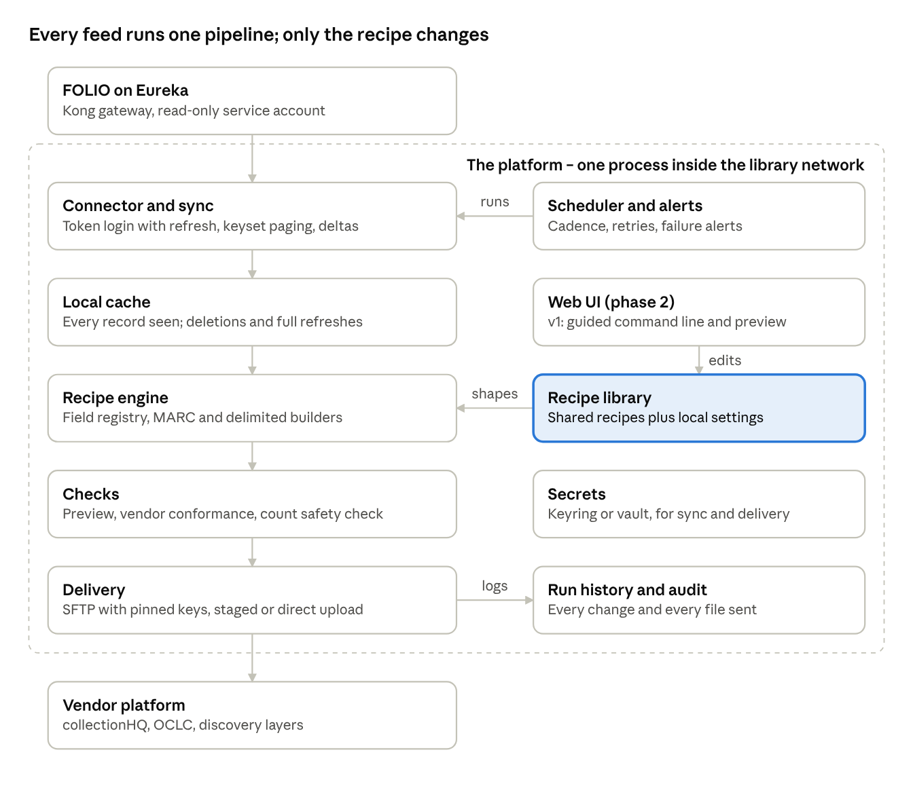

# FOLIO-Exchange

An open-source tool that lets libraries set up, test and run scheduled data exchanges between [FOLIO](https://www.folio.org/) and vendor platforms – collectionHQ first – from shared, tested recipes, without writing code.

**Status:** v1 is in development (`0.1.0.dev0`). It runs end to end against a mock FOLIO and is not yet released. The collectionHQ Academic recipe and its setup guide live in [FOLIOHQ](https://github.com/ByYudkowskysTentacle/FOLIOHQ), whose original tool (phase 0, now in its `legacy/` folder) writes byte-identical files and stays as a fallback until the first real delivery. Read the [spec sheet](docs/spec.md), the [build design](docs/design.md) and the [working notes](docs/notes.md).



- **Eureka-based FOLIO** is the target. Okapi keeps working only where the same code covers it.
- **Read-only, and never patron data.** The FOLIO client can only read the records a recipe names; user and patron endpoints are refused before any request is sent.
- **No passwords in files.** Secrets live in the system keyring or environment variables.
- **Nothing reaches a vendor unchecked.** The first delivery to a destination waits for a person to release it, and a sudden drop in items blocks a run.

This is a community project. It is not affiliated with or endorsed by the FOLIO project or any vendor.

## How it works

A **site** folder holds one FOLIO tenant's settings (`site.yaml`) and one file per **feed** (`feeds/chq.yaml`). A feed picks a shared, versioned **recipe** – the vendor's file layout, such as `chq-academic@^1.0` – and adds only local choices: locations to leave out, the SFTP account, the schedule. Every run syncs a local cache from FOLIO, builds the files, checks them, and delivers them or holds them for review, and records what it sent.

## Try it (developers)

Python 3.10 or later.

```bash
python -m venv .venv
```

```bash
.venv/Scripts/python -m pip install -e ".[dev]"
```

(On Linux or macOS the interpreter is `.venv/bin/python`.) Then run the tests, which use a mock FOLIO and never touch a real tenant, SFTP server or keyring:

```bash
.venv/Scripts/python -m pytest -q
```

## Setting up a library (once released)

To try it against your own tenant first, without sending anything to a vendor, follow the [dry-run guide](docs/dry-run.md). To go live with collectionHQ Academic, follow FOLIOHQ's [setup guide](https://github.com/ByYudkowskysTentacle/FOLIOHQ/blob/main/docs/setup.md).

```bash
folio-exchange init C:\FOLIO-Exchange\mylibrary
```

The guided setup asks for the FOLIO API address, tenant and a read-only service account; stores the password in the system keyring; checks the account's permissions; offers the tenant's own locations to leave out; builds a preview; reads the vendor server's key for you to compare with the vendor's; and sets the schedule and alerts. Then:

| Command | What it does |
| --- | --- |
| `folio-exchange run chq` | Sync, build and check; the first delivery is held for you |
| `folio-exchange release chq` | Show the held run and send it once you confirm |
| `folio-exchange schedule` | Print the one command that runs `run --due` every hour |
| `folio-exchange feeds` | Each feed's recipe, schedule, last run and next step |
| `folio-exchange check` | Test the login, permissions and record counts (`--delivery` tests the vendor login, `--alerts` sends a test alert) |
| `folio-exchange preview chq` | Sample live data and show rows, without delivering |
| `folio-exchange recipes summary chq` | The one-page file layout to send the vendor |
| `folio-exchange history --audit` | Who changed, released or upgraded what |
| `folio-exchange ui` | A simple page in your browser to look at feeds, run them and review held runs |

`examples/` has a commented `site.yaml` and feed file, and `src/folio_exchange/schemas/` has JSON Schemas so editors can check them.

**License:** [MIT](LICENSE), the same as FOLIOHQ. Code adapted from FOLIOHQ keeps its own MIT notice (see [NOTICE.md](NOTICE.md)).
