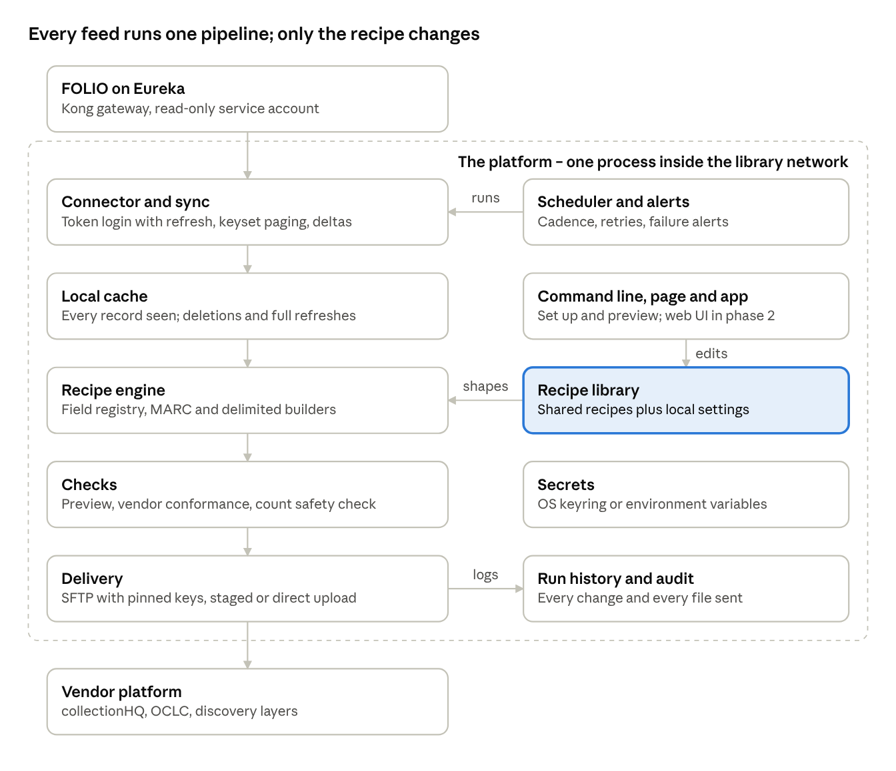

# FOLIO-Exchange

FOLIO-Exchange lets a library set up, test and run scheduled exports from [FOLIO](https://www.folio.org/) to vendor platforms – collectionHQ first – from shared, tested recipes, without writing code. Loading data into FOLIO is planned for a later version.

**Status:** v1 is in development, and [0.2.0](https://github.com/ByYudkowskysTentacle/FOLIO-Exchange/releases/tag/v0.2.0) is its first pre-release. Its tests run offline against a mock FOLIO, and it has run end to end against FOLIO's public Eureka test system. It hasn't yet run against a library's own tenant or delivered to collectionHQ. The [working notes](docs/notes.md) say where things stand.



- **FOLIO on Eureka is the target.** Okapi-based FOLIO works where the same code serves both; nothing is built for Okapi alone.
- **Read-only, and no patron data.** The FOLIO client sends only read requests, plus its login, to a fixed list of inventory, loan, MARC and reference-data paths. User and patron paths are refused before any request is sent, a loan's borrower is dropped as the record arrives, and a recipe that asks for patron data is refused.
- **No passwords in files.** Passwords live in the system keyring (Windows Credential Manager) or in environment variables. The one exception is an SFTP private key, too large for Credential Manager, which is a file only your Windows user can read.
- **Nothing reaches a vendor unchecked.** The first delivery to a destination waits for a person to release it, and so does the first after a change to the files' layout or the recipe's major version, or from a different FOLIO. A sudden drop in items, or rows missing values the vendor needs, stops the delivery until someone looks.

FOLIO-Exchange is an independent community project. It isn't affiliated with, sponsored by or endorsed by the FOLIO project, the Open Library Foundation, collectionHQ, OCLC or any other vendor.

## How it works

A **site** folder holds one FOLIO tenant's settings (`site.yaml`) and one file per **feed** (`feeds/chq.yaml`). A feed picks a shared, versioned **recipe** – the vendor's file layout, such as `chq-academic@^1.0` – and adds only local choices: locations to leave out, the SFTP account, the schedule. Every run syncs a local cache from FOLIO, builds the files, checks them, delivers them or holds them for review, and records what it sent.

## What you need

- **FOLIO**, preferably on Eureka, and a FOLIO user that can read inventory, loans and reference data. `folio-exchange check` lists the permissions it needs and tests them.
- **A PC** that your FOLIO accepts API traffic from (usually one inside the library's network) and that's on when runs are due. Windows 10 or 11 is the main target, with an installer and an hourly Windows scheduled task. On Linux, and untested on macOS, it runs from the command line, and `schedule` prints a crontab line instead.
- **Python 3.10 or later.** The Windows installer can add it for you.
- **The vendor's SFTP account** and its server key fingerprint, for real deliveries. A dry run needs neither.

**Feeds today:** collectionHQ Academic – full MARC 21 bibs and a pipe-delimited item file with loan and renewal counts, over SFTP (the [file layout](https://github.com/ByYudkowskysTentacle/cHQ-FOLIO-Exchange-Recipe/blob/main/docs/layout.md) lists every column). Other feeds, such as OCLC WorldCat holdings and discovery layers, are candidates ([integration catalogue](docs/spec.md#integration-catalogue)). To ask for one, open a [recipe request](https://github.com/ByYudkowskysTentacle/FOLIO-Exchange/issues/new?template=recipe_request.yml).

## Getting started

### On a Windows PC

Run the [installer](installer/README.md): download it and double-click `install.cmd`. It installs FOLIO-Exchange for your Windows user, with no administrator rights needed, puts a launcher on the desktop, offers to set up the hourly scheduled runs, and opens the setup page in your browser. For safety, the page opens only from the launcher, through a link that works once; if you close the browser, double-click the launcher again.

On that page you connect to FOLIO, then add as many vendor feeds as you need: choose a vendor's recipe, the locations and statuses to leave out and a schedule, then the vendor's SFTP server and password or key. Passwords go straight into Windows Credential Manager. A new feed starts paused, and until it has a delivery it's a dry run that sends nothing. The first delivery to each destination waits for you to review it. Vendors' recipes come from a curated list (today, collectionHQ, from [cHQ FOLIO Exchange Recipe](https://github.com/ByYudkowskysTentacle/cHQ-FOLIO-Exchange-Recipe)), and the page installs a new version only after you've seen what changed.

### At the command line

To try it against your own tenant first, without sending anything to a vendor, follow the [dry-run guide](docs/dry-run.md). It goes on to the first real delivery and to updating FOLIO-Exchange. For collectionHQ Academic, the [setup guide](https://github.com/ByYudkowskysTentacle/cHQ-FOLIO-Exchange-Recipe/blob/main/docs/setup.md) in cHQ FOLIO Exchange Recipe covers going live in full.

With FOLIO-Exchange installed and on your PATH (section 1 of the dry-run guide), start the guided setup:

```powershell
folio-exchange init $env:LOCALAPPDATA\FOLIO-Exchange\mylibrary
```

It asks for the FOLIO API address, tenant and a read-only account; stores the password in the system keyring; checks the account's permissions; offers the tenant's own locations to leave out; builds a preview; reads the vendor server's key for you to compare with the vendor's; and sets the feed's schedule and the alerts. Nothing runs on its own until the hourly task is registered with `folio-exchange schedule --register`.

The commands below work on the site in the current folder, or on the one named with `-s <site folder>`.

| Command | What it does |
| --- | --- |
| `folio-exchange run chq` | Sync, build, check and deliver; the first delivery is held for you |
| `folio-exchange run chq --no-deliver` | A dry run: build and check, and send nothing |
| `folio-exchange release chq` | Show the held run and send it once you confirm |
| `folio-exchange feeds` | When the hourly task last ran, then each feed's recipe, schedule, last run and next step |
| `folio-exchange feeds resume chq` | Let a paused feed run on its schedule (`feeds pause chq` stops it) |
| `folio-exchange check` | Test the login, permissions and record counts (`--delivery` tests the vendor login, `--alerts` sends a test alert) |
| `folio-exchange preview chq` | Sample live data and show rows, without delivering |
| `folio-exchange schedule` | Print the command that sets up `run --due` every hour (also on battery power), in a PowerShell and a Command Prompt form |
| `folio-exchange schedule --register` | Set up the hourly scheduled runs now (Windows asks for your Windows password) |
| `folio-exchange secret set chq` | Store a password or secret URL again (`folio`, `smtp`, `webhook`, `heartbeat` or a feed name); `secret status` shows where each comes from |
| `folio-exchange recipes summary chq` | The one-page file layout to send the vendor |
| `folio-exchange recipes get foliohq` | Check a vendor's recipes on GitHub for new versions, and install them after you confirm (`recipes sources` lists the sources; `foliohq` is the collectionHQ source, named after its repository's former name) |
| `folio-exchange upgrade chq` | Move a feed to a newer recipe version, after showing what changes |
| `folio-exchange history --audit` | Who changed, released or upgraded what |
| `folio-exchange ui` | The browser page: set up the site and its feeds, run them and review held runs. It opens through a one-time link; `--no-browser` prints the link instead |
| `folio-exchange launcher` | Put a file on your desktop that opens that page with a double-click (again after closing the browser) |
| `folio-exchange rename-site NAME` | Give the site folder a new name, such as the library's (also under Options on the page) |
| `folio-exchange app` | Open the desktop app for this site |

`folio-exchange --help`, and `--help` after any command, lists every command and option. `examples/` has a commented `site.yaml` and feed file, and `src/folio_exchange/schemas/` has JSON Schemas so editors can check them.

### Desktop app (preview)

A Windows desktop app, with a window of its own for each site, is in preview ([plan](docs/desktop-plan.md)). It does what the browser page does: it sets up a new site (connecting to FOLIO, then adding a vendor feed), shows and runs each feed, releases held deliveries, edits a feed's settings and delivery (with the SFTP server key check), stores its password or key, gets recipes from vendors and renames the site folder. It also registers the scheduled task and sets up alerts. The browser page stays available from the app (Ctrl+B).

The installer doesn't include the app yet. It needs Qt (PySide6), an optional extra, and Python from python.org: some Python builds, such as Anaconda's, can't load Qt. In a development checkout (below):

```powershell
.venv/Scripts/python -m pip install -c constraints.txt -e ".[desktop]"
```

Then start it with `.venv/Scripts/folio-exchange-app` (it opens no console window on Windows), or from a console with `folio-exchange --site <site folder> app`. Without a site, it offers the sites opened before, a site folder, or a new site. Starting it again for a site that's already open brings that window to the front.

### For developers

You need Python 3.10 or later and Git.

```powershell
git clone https://github.com/ByYudkowskysTentacle/FOLIO-Exchange.git
cd FOLIO-Exchange
python -m venv .venv
.venv/Scripts/python -m pip install -c constraints.txt -e ".[dev,desktop]"
```

On Linux or macOS the interpreter is `.venv/bin/python`. `constraints.txt` holds the dependency versions the tests pass with; CI and the installer use it too. Then run the tests, which use a mock FOLIO and never touch a real tenant, SFTP server or keyring, and the linter:

```powershell
.venv/Scripts/python -m pytest -q
.venv/Scripts/ruff check .
```

The desktop app's widget tests run only when Qt loads; otherwise they're skipped. [CONTRIBUTING.md](CONTRIBUTING.md) has the ground rules and how to send a change.

## Documentation

The [docs index](docs/README.md) lists every document by reader and explains the terms they use. The main ones:

- [Windows installer](installer/README.md) and [dry-run guide](docs/dry-run.md) – for library staff setting it up.
- [Spec sheet](docs/spec.md) – goals, roles, the feeds it aims to cover, requirements, safety rules and roadmap.
- [Build design](docs/design.md) – the v1 build contract: site and feed files, the recipe format, every module, the command line and tests.
- [Working notes](docs/notes.md) – where things stand, the decisions so far and why, and what's been learned about FOLIO and collectionHQ.

## Help and contributing

- **A bug or a question:** open an [issue](https://github.com/ByYudkowskysTentacle/FOLIO-Exchange/issues). Issues are public, so never include passwords, keys, patron data or your site's settings.
- **A feed you need:** open a [recipe request](https://github.com/ByYudkowskysTentacle/FOLIO-Exchange/issues/new?template=recipe_request.yml).
- **A change:** see [CONTRIBUTING.md](CONTRIBUTING.md).
- **A security problem:** report it privately, as [SECURITY.md](SECURITY.md) explains.

## License and trademarks

FOLIO-Exchange is released under the [MIT License](LICENSE), the same as cHQ FOLIO Exchange Recipe. Code adapted from that repository's original tool, folio-chq-extract, keeps its own MIT notice (see [NOTICE.md](NOTICE.md)).

FOLIO, collectionHQ, OCLC, WorldCat and other product names are trademarks or registered trademarks of their owners. They're used here only to say which systems FOLIO-Exchange works with.
